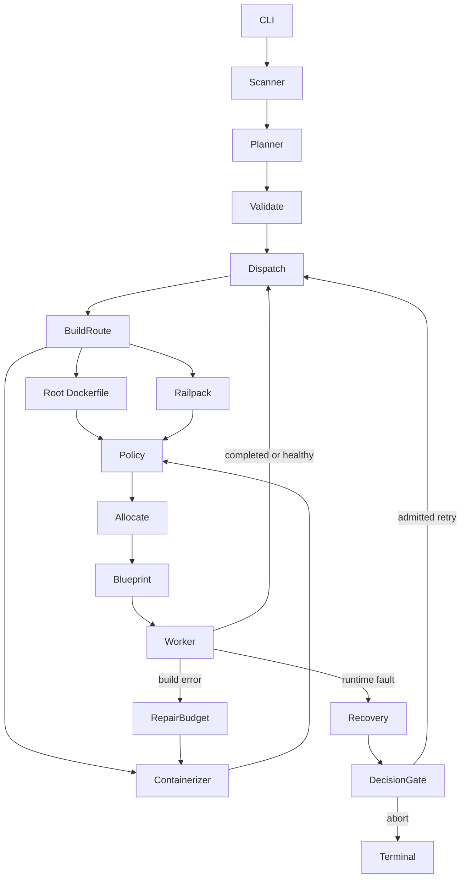

# OFFDOCK agent architecture

OFFDOCK turns a request about one or more pinned repositories into independently scheduled container workloads. This repository contains the architecture specification. The manager owns the job record and policy decisions. Three model calls can propose a plan, a Dockerfile, or a runtime recovery action. Only a worker with a valid lease can build or run the selected workload.

The diagram shows logical dependencies. Planning consumes a read-only scan. Each dispatched task reuses the same report by commit and selects its workload-specific build inputs. Build preparation can overlap capacity discovery. A reservation must still succeed before the manager issues a blueprint.

## Implementation map

| Proposed module | Owns |
| --- | --- |
| shared/schemas.py and security.py | Wire models, blueprint authentication and policy admission |
| manager/graph/planner.py | Prompt invocation and candidate plan validation |
| manager/graph/containerizer.py | Build tier selection and repair proposals |
| manager/graph/recovery.py | Runtime incident analysis and proposed decisions |
| manager/graph/state.py and workflow.py | Durable job, task, attempt and event state, reducers and conditional dispatch |
| manager/scheduler/registry.py and allocator.py | Worker epochs, health, reservations and capacity |
| worker/daemon.py, builder.py, sandbox.py, telemetry.py and watchdog.py | Blueprint acceptance, isolated build/run, lifecycle evidence and heartbeats |

The proposed modules above describe future implementation. Read the [source comparison](docs/research.md), [planning contract](docs/planning.md), [dispatch protocol](docs/dispatch.md), [build routes](docs/builds.md) and [recovery decisions](docs/recovery.md). The exact model instructions live in [prompts](prompts/) and their wire contracts in [contracts](contracts/).

## Walk through a job

Follow the [sample plan and acceptance cases](docs/acceptance.md) from initial dispatch through service readiness, a failed attempt and artifact fan-in. The JSON schemas describe the model response shapes. DAG validity, evidence matching, allocation and attempt ownership require the manager checks described above.

## Python architecture

Install with Python 3.11 or newer using a virtual environment and pip install -e .
The manager.graph modules implement typed model invocation, evidence-bound plan
validation, three-tier build selection, bounded recovery proposals and LangGraph
dispatch. Supply a ModelClient implementation to call your chosen provider.
create_workflow accepts an asynchronous claim_and_enqueue adapter.

Deployment integrations still require a durable claim/outbox store, repository
scanner, security validation adapter, Railpack adapter, allocator, registry and
worker runtime. The build validator must enforce policy before accepting an
artifact. BuildHistory is an in-memory value and must be persisted under the
task's attempt transaction by the deployment adapter.
