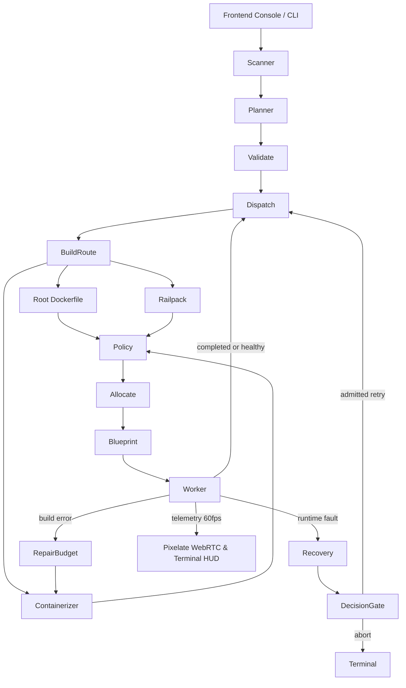

# OFFDOCK / Sathack Agent Architecture & Frontend Console

OFFDOCK turns a request about one or more pinned repositories into independently scheduled container workloads. This repository contains the FastAPI control server, remote Docker agent, architecture specification, and the **Next.js 14 Agentic Orchestrator Frontend Console** located in `/frontend`.

---

## 🌐 Live Deployable Demo Link (ngrok)

A live public tunnel has been launched for the frontend console:
* **Live Web URL:** [https://unstaffed-retract-nylon.ngrok-free.dev/sathack](https://unstaffed-retract-nylon.ngrok-free.dev/sathack)
* **Local Development Route:** `http://localhost:3000/sathack`
* **Status:** Online · Tunnel valid for active session.

---

## Architecture Flow



---

## 🎨 Frontend Details (For Engineers & LLMs)

The user-facing console lives in `/frontend` and was built according to **`pbakaus/impeccable`** and `/design-taste-frontend` craft guidelines:

* **Tech Stack:** Next.js 14 App Router, React 18, TypeScript, Tailwind CSS, Lucide Icons.
* **Palette:**
  * **Cream (`#F3EEE3`):** High-contrast editorial typography and secondary gauges.
  * **Ink Black (`#111111`):** Deep obsidian canvas, terminal console viewport, and card surfaces.
  * **Burnt Orange (`#D9541E`):** Primary action buttons, active pipeline steps, and download triggers.
* **Core Components in `frontend/components/orchestrator/OrchestratorAgentApp.tsx`:**
  1. **Repository Ingestion:** Ingests any GitHub repo (`jeevanshbhatia650-rgb/sathack`) with branch selection.
  2. **Top Terminal HUD:** Monospace Dockerfile CLI stream with live container logs and an instant **Download Release Artifact (`.tar.gz`)** button.
  3. **Infographic Telemetry Gauges:** Concentric circular progress arcs, radial speedometers, and vertical capsule equalizers tracking WebRTC frame-buffer load and GPU memory.
  4. **ChatGPT-Style Assistant:** Conversational prompt bar with attached configuration chips (`Dockerfile`, `pixelate.config.json`) and tools drawer.

---

## 🔌 How to Connect Frontend to the FastAPI Backend

For another LLM or developer wiring the frontend to the backend:

1. **Backend Endpoints (`orchestrator/main.py`):**
   * `GET /healthz` — Health check endpoint.
   * `POST /v1/jobs` — Accepts `{ "repo": string, "branch": string, "targets": ["dockerfile"] }` to queue a container build.
   * `GET /v1/jobs/{job_id}/stream` — Server-Sent Events (SSE) streaming real-time Docker build logs directly into the terminal HUD.
   * `WS /ws/cluster` — WebSocket connection broadcasting live telemetry frames (`{"type": "TELEMETRY", "fps": 60.0, ...}`) to update the concentric arcs and speedometers.
   * `POST /v1/nodes/pair` — Authenticated node pairing for remote Docker workers.

2. **Frontend Environment Setup (`frontend/.env.local`):**
   ```bash
   NEXT_PUBLIC_ORCHESTRATOR_API_URL=http://localhost:8000
   NEXT_PUBLIC_ORCHESTRATOR_WS_URL=ws://localhost:8000/ws/cluster
   NEXT_PUBLIC_ADMIN_KEY=<ADMIN_DASHBOARD_KEY>
   ```

3. **Running the Frontend Locally:**
   ```bash
   cd frontend
   npm install
   npm run dev
   ```
   Visit `http://localhost:3000/sathack`.

*Detailed integration code snippets and full wire models are documented in [`frontend/FRONTEND_INTEGRATION_GUIDE.md`](frontend/FRONTEND_INTEGRATION_GUIDE.md).*

---

## Implementation map

| Proposed module | Owns |
| --- | --- |
| `frontend/` | Next.js 14 Agentic Orchestrator, Terminal HUD, Infographic Gauges & WebRTC Telemetry |
| `shared/schemas.py` and `security.py` | Wire models, blueprint authentication and policy admission |
| `manager/graph/planner.py` | Prompt invocation and candidate plan validation |
| `manager/graph/containerizer.py` | Build tier selection and repair proposals |
| `manager/graph/recovery.py` | Runtime incident analysis and proposed decisions |
| `manager/graph/state.py` and `workflow.py` | Durable job, task, attempt and event state, reducers and conditional dispatch |
| `manager/scheduler/registry.py` and `allocator.py` | Worker epochs, health, reservations and capacity |
| `worker/daemon.py`, `builder.py`, `sandbox.py` | Blueprint acceptance, isolated build/run, lifecycle evidence and heartbeats |

---

## Run the Backend Orchestrator

1. Install requirements in a virtual environment:
   ```bash
   pip install -r requirements-dev.txt
   pytest -v
   ```
2. Start the FastAPI server:
   ```bash
   uvicorn orchestrator.main:app --host 0.0.0.0 --port 8000
   ```
3. Use the frontend at `http://localhost:3000/sathack` to submit workloads and inspect real-time execution.
