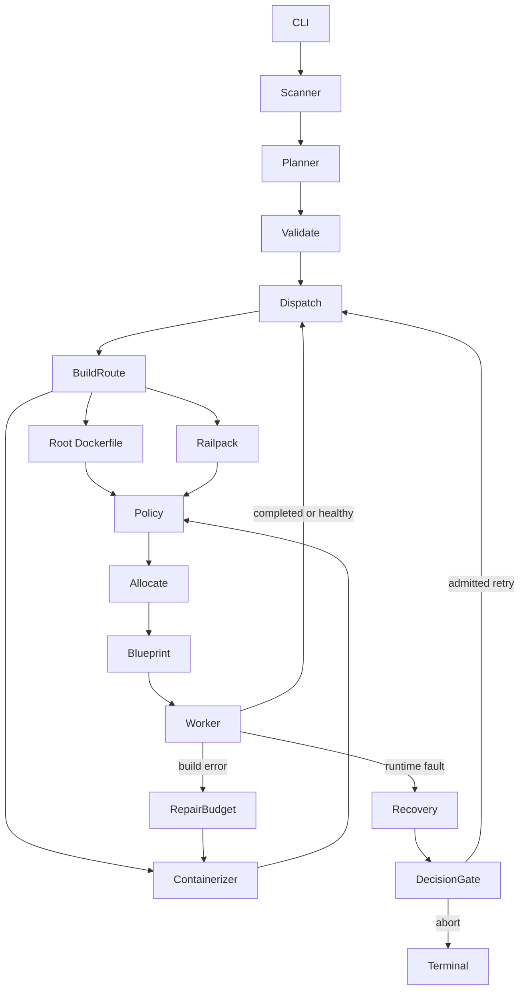

# OFFDOCK agent architecture

OFFDOCK turns a request about one or more pinned repositories into independently scheduled container workloads. This repository contains the architecture specification. The manager owns the job record and policy decisions. Three model calls can propose a plan, a Dockerfile, or a runtime recovery action. Only a worker with a valid lease can build or run the selected workload.

The diagram shows logical dependencies. Planning consumes a read-only scan. Each dispatched task reuses the same report by commit and selects its workload-specific build inputs. Build preparation can overlap capacity discovery. A reservation must still succeed before the manager issues a blueprint.
